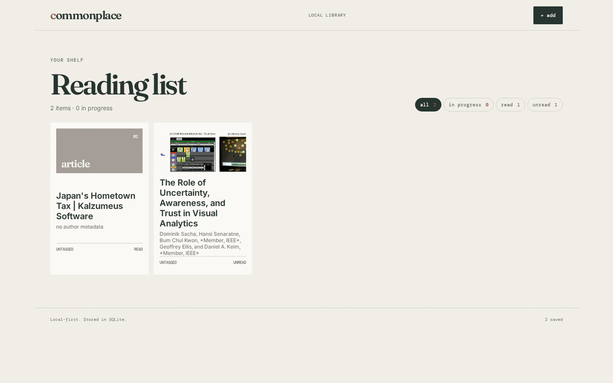
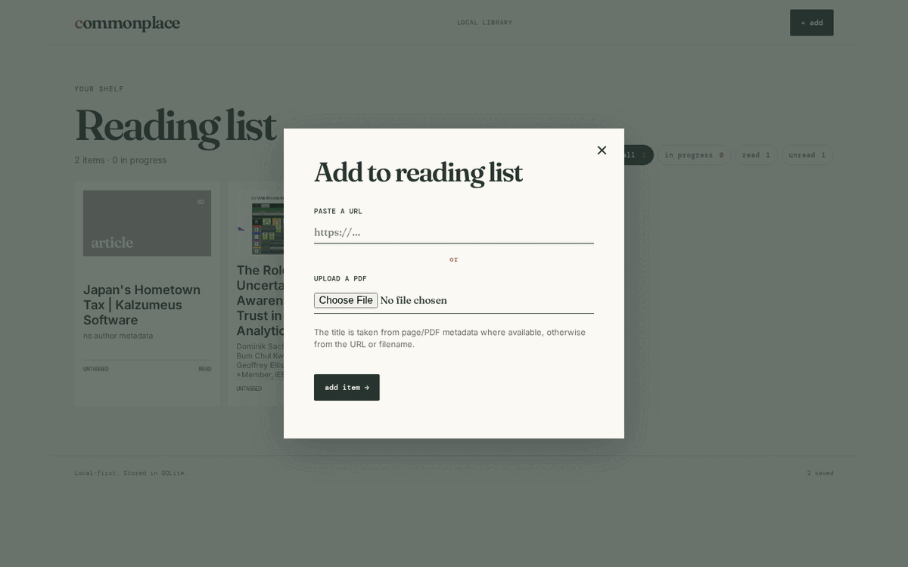
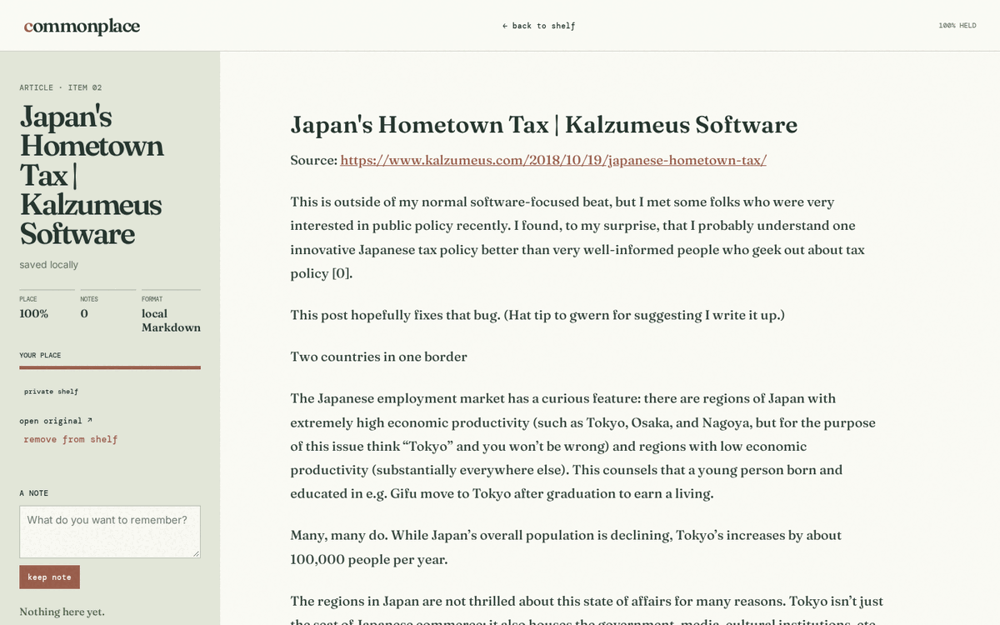
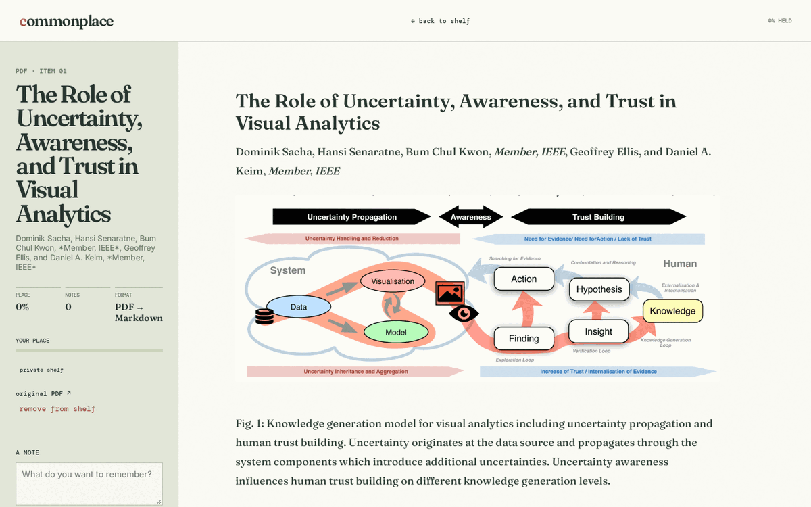

# Commonplace

A local-first, private reading list. Save URLs and PDFs, read them as clean local Markdown, jot notes in the margin, and pick up where you left off. No accounts, no sharing, no cloud — everything lives in a SQLite file on disk.



## What it is

- **Private by default** — single-user, no login, no telemetry, no hosted capture APIs.
- **Local-first** — items, notes, tags, and reading progress all live in one SQLite file. Delete `data/` and you're back to zero.
- **Format-agnostic reading** — both web articles and PDFs are converted to Markdown on capture, so the reader is the same surface either way, and progress tracking means something for both.

## How it works

**Add to shelf** — paste a URL or upload a PDF.



- A **URL** is fetched by a self-hosted [Firecrawl](https://github.com/mendableai/firecrawl) instance if you've configured one, otherwise by a bounded local fetch + [Readability](https://github.com/mozilla/readability) extraction (public HTTP(S) only, no loopback/private/link-local targets, no redirects, time and size capped). A URL that turns out to be a PDF — by content-type or magic bytes, not just its extension — is routed to the PDF path instead.
- A **PDF** is converted by the optional `services/pdf-markdown` service (a FastAPI wrapper around locally run [Marker](https://github.com/datalab-to/marker), good with complex layouts and extracted figures) when `PDF_SERVICE_BASE_URL` is set, falling back to a lightweight PDF.js text-layer extraction otherwise. The original file is always kept alongside the Markdown.

**Read** — the reader always shows the local Markdown copy, with the original (`source.html` / `original.pdf`) one click away for reference.





- Scroll position and percent-read are saved automatically as you read.
- Margin notes are saved per item.
- Fetched content is untrusted: it's rendered as escaped Markdown, never raw HTML.

Everything captured lands in `data/library/<item-id>/` (original file, `content.md`, `assets/`); SQLite (`data/commonplace.sqlite`) tracks items, capture provenance, tags, notes, and progress. The schema is in `db/schema.sql`.

## Running it

Requires Node 22.5+ (uses the built-in `node:sqlite` module).

```sh
npm start
# open http://localhost:4173
```

- `npm run dev` — restarts the server on file changes.
- `npm run check` — syntax-checks the server and browser script.
- `npm test` — runs the test suite.

Copy `.env.example` to `.env` to adjust capture limits or wire up the optional Firecrawl/PDF services. Both are off by default — URL capture falls back to local Readability, PDF capture falls back to PDF.js.

### Developing against Firecrawl + the PDF service

```sh
scripts/dev-bootstrap.sh    # once: clones Firecrawl at a pinned tag into .dev/firecrawl
docker compose -f compose.yaml -f compose.dev.yaml up -d
```

The bootstrap script prints the `FIRECRAWL_BASE_URL` / `PDF_SERVICE_BASE_URL` values to add to `.env`. Those are `localhost` URLs for running Commonplace with `npm start` on the host; if Commonplace itself runs in the container, use the Compose service name instead (e.g. `http://pdf-markdown:8008`).

## Deployment

**Docker** (recommended — isolates the data volume, binds to loopback by default):

```sh
cp .env.example .env
docker compose up -d --build
```

`compose.yaml` alone is the production stack — just Commonplace, no Firecrawl, no PDF service. Point `FIRECRAWL_BASE_URL` / `PDF_SERVICE_BASE_URL` at wherever those run, or leave `PDF_SERVICE_BASE_URL` blank to use the PDF.js fallback. Never point `FIRECRAWL_BASE_URL` at hosted Firecrawl Cloud — only a self-hosted instance.

**Bare host / LXC**, via the install script (review it before piping into a shell):

```sh
curl -fsSL https://raw.githubusercontent.com/commrelayunit/commonplace/main/scripts/install.sh | sh
# or, inside an LXC with Node 22.5+ already installed:
curl -fsSL https://raw.githubusercontent.com/commrelayunit/commonplace/main/scripts/install.sh | sh -s -- --mode lxc
```

This installs dependencies and prepares `data/`; run `npm start` under your service manager of choice. Neither install path deploys Firecrawl — add its private URL to `.env` only once that instance has its own outbound SSRF protections.
